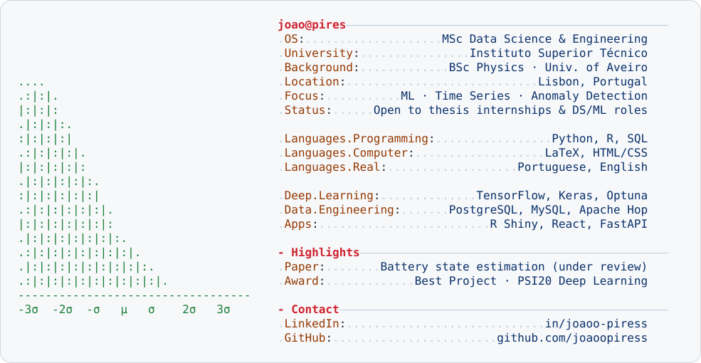

<a href="https://www.linkedin.com/in/joaoo-piress/">
  <picture>
    <source media="(prefers-color-scheme: dark)" srcset="./dark_mode.svg">
    
  </picture>
</a>

  
  
  

### About me

Physicist turned data scientist. I'm finishing an **MSc in Data Science & Engineering at Instituto Superior Técnico** (expected July 2027), after a **BSc in Physics** at the University of Aveiro. I like problems where the signal is buried in noise: **time series, anomaly detection and financial data**. I build end-to-end, from cleaning raw data and engineering features to training, tuning and shipping models in an app someone can use.

---

### Main skills

### Studying

---

### Education

| Degree | Institution | Dates |
|---|---|---|
| MSc Data Science and Engineering | Instituto Superior Técnico, Lisbon | 2025 – 2027 (expected) |
| BSc Physics | University of Aveiro | Graduated July 2025 |

<b>📚 Study notes (LaTeX)</b> — summaries I write to bridge theory and implementation

 

- [Machine Learning](https://github.com/joaoopiress/joaoopiress/blob/main/Data-Science-Foundations/ML_Notes.pdf)
- [Deep Learning](https://github.com/joaoopiress/joaoopiress/blob/main/Data-Science-Foundations/DL_Notes.pdf)
- [Computational Statistics](https://github.com/joaoopiress/joaoopiress/blob/main/Data-Science-Foundations/Comp_Statics_Notes.pdf)
- [Analytical Mechanics & Relativity](https://github.com/joaoopiress/joaoopiress/blob/main/Data-Science-Foundations/Analitical_Mec_Relativity_Notes.pdf)
- [Waves](https://github.com/joaoopiress/joaoopiress/blob/main/Data-Science-Foundations/Waves_Notes.pdf)

---

### Connect with me!

### Employer?

> [!IMPORTANT]
> I'm open to **MSc thesis internships** and **Ai Engineering / ML roles**. 
> [**Download my resume**](./CV-JoaoPires.pdf)
